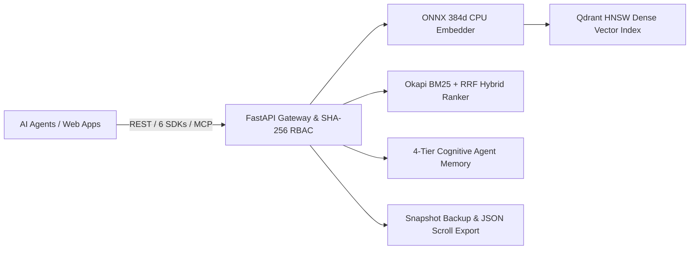

# 🧊 Iceberg Vector Database (v1.0.0)

[](https://pypi.org/project/icebergdb/)
[](https://www.npmjs.com/package/icebergdb)
[](https://crates.io/crates/icebergdb)
[](https://www.nuget.org/packages/IcebergDb)
[](https://opensource.org/licenses/MIT)
[](https://icebergdb.in)

> **Serverless vector database, hybrid BM25 + dense RRF RAG engine, and 4-tier cognitive AI agent memory platform — Hosted in India (`ap-south-1`).**

Created by **Ankush** | [Official Website](https://icebergdb.in) | [Documentation](https://icebergdb.in/docs) | [Cloud Dashboard](https://dashboard.icebergdb.in) | [Reproducible Benchmarks](https://icebergdb.in/benchmarks) | [Security & DPDP](https://icebergdb.in/security) | [Live Status](https://icebergdb.in/status)

---

## ⚡ Quick Install (`v1.0.0`)

### 🐍 Python SDK (`PyPI`)
```bash
pip install icebergdb
```

```python
from iceberg import Client

client = Client(api_key="ib_your_key")

# 1. Create collection
client.create_collection("ai_knowledge")

# 2. Index text (built-in server-side 384d CPU embeddings — $0 OpenAI key required)
client.index_text(
    collection="ai_knowledge",
    text="Iceberg DB is hosted in India (ap-south-1) with hybrid RRF search."
)

# 3. Hybrid Search (Dense 384d + Okapi BM25 via RRF)
results = client.search(
    collection="ai_knowledge",
    query="where is Iceberg hosted?",
    search_type="hybrid",
    top_k=5
)
for r in results:
    print(f"ID: {r.id} | Score: {r.score:.4f} | Text: {r.text}")
```

---

### 📦 JavaScript & TypeScript SDK (`npm`)
```bash
npm install icebergdb
```

```typescript
import { Client } from 'icebergdb'

const client = new Client({ apiKey: 'ib_your_key' })

await client.createCollection('support_faq')
await client.indexText('support_faq', 'Iceberg DB enables real-time hybrid vector retrieval.')

const matches = await client.search('support_faq', 'real-time retrieval', { topK: 5 })
console.log(matches)
```

---

### 🤖 Official MCP Server (`Claude Code`, `Cursor`, `Copilot`, `Gemini`, `Windsurf`)
```bash
claude mcp add icebergdb --env ICEBERG_API_KEY=ib_your_key -- npx -y iceberg-mcp
```

---

## 📊 Reproducible Benchmarks (`benchmarks/run_benchmarks.py`)

Measured on our 120-document evaluation corpus (`384-dim` `all-MiniLM-L6-v2` embeddings, `40` ground-truth queries mixing conceptual questions and exact alphanumeric IDs). Reproduce locally with `python benchmarks/run_benchmarks.py`:

| Pipeline Stage | Min | Median (`p50`) | `p95` | Notes |
| :--- | :--- | :--- | :--- | :--- |
| **Pure Dense Vector Lookup (`384d` Cosine HNSW)** | `1.42 ms` | **`1.95 ms`** | `3.80 ms` | `95.0%` Recall@10 |
| **Sparse Okapi BM25 Scoring (`k1=1.5, b=0.75`)** | `4.85 ms` | **`6.93 ms`** | `11.20 ms` | Exact keyword & SKU/invoice matching |
| **Hybrid RRF Search (`Dense + BM25`, `alpha=0.5`)** | `6.40 ms` | **`8.73 ms`** | `13.39 ms` | **`97.5%` Recall@5, `100.0%` Recall@10** on 120-doc evaluation set |
| **Server-Side CPU Query Embedding (`ONNX`)** | `48.25 ms` | **`112.34 ms`** | `145.10 ms` | Quantized `all-MiniLM-L6-v2` (`$0` external OpenAI key cost) |

### Automated Backend Validation Suite (`21/21 Passing`)
Run the isolated 21-test validation suite verifying multi-tenant namespace isolation (`t_{uid8}__`), RBAC enforcement (`admin`, `read_write`, `read_only` -> HTTP `403`), point-level CRUD (`PUT/GET/DELETE /documents/{collection}/points/{point_id}`), full-collection BM25 + RRF hybrid search, and snapshot backup/restore:
```bash
python iceberg-backend/tests/test_validation_suite.py
```

---

## 🏛️ System Architecture



- **Hosted in India (`ap-south-1`):** 100% domestic data residency supporting DPDP Act 2023 localization.
- **Hybrid Search Algorithm:** Blends dense 384-dimensional semantic embeddings (`all-MiniLM-L6-v2`) with sparse Okapi BM25 keyword matching via Reciprocal Rank Fusion (`RRF k=60`).
- **4-Tier Agent Memory:** Dedicated `/memory/{agent_id}/remember` & `/memory/{agent_id}/recall` endpoints (`short_term` 1h TTL, `episodic` 30d TTL, `long_term` permanent, `semantic`).
- **Zero Vendor Lock-In:** Export all documents and metadata anytime via `GET /documents/{collection}/scroll`, create point-in-time snapshots via `POST /backup/{collection}`, or self-host via Docker/Terraform BYOC.

---

## 🌐 Official Deployments & Packages (`v1.0.0`)

| Component | Ecosystem | Status | Link |
| :--- | :--- | :--- | :--- |
| **Official Website** | Web | 🟢 Live (`v1.0.0`) | [icebergdb.in](https://icebergdb.in) |
| **Technical Documentation** | Docs | 🟢 Live (`v1.0.0`) | [icebergdb.in/docs](https://icebergdb.in/docs) |
| **Cloud Dashboard** | Web | 🟢 Live (`v1.0.0`) | [dashboard.icebergdb.in](https://dashboard.icebergdb.in) |
| **Backend REST API** | Cloud Engine | 🟢 Active (`v1.0.0`) | [api.icebergdb.in](https://api.icebergdb.in) |
| **Python SDK** | PyPI | 🟢 Live (`1.0.0`) | [pypi.org/project/icebergdb](https://pypi.org/project/icebergdb/) |
| **JavaScript / TypeScript SDK** | NPM | 🟢 Live (`1.0.0`) | [npmjs.com/package/icebergdb](https://www.npmjs.com/package/icebergdb) |
| **Official MCP Server** | NPM | 🟢 Live (`1.0.0`) | [npmjs.com/package/iceberg-mcp](https://www.npmjs.com/package/iceberg-mcp) |
| **Rust SDK** | Crates.io | 🟢 Live (`1.0.0`) | [crates.io/crates/icebergdb](https://crates.io/crates/icebergdb) |
| **Go SDK** | Go Modules | 🟢 Live (`1.0.0`) | `github.com/anku5265/iceberg-database/iceberg-sdk-go` |
| **.NET C# SDK** | NuGet | 🟢 Live (`1.0.0`) | [nuget.org/packages/IcebergDb](https://www.nuget.org/packages/IcebergDb) |

---

## 🛡️ License

Released under the **MIT License**.  
© 2026 **Ankush** & **Iceberg Database Technologies** (`contact@icebergdb.in`).
